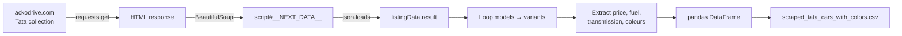

# Web Scraping Project — Tata Cars 🚗


A Python scraper that collects every **Tata car model and variant**, with price, fuel type, transmission and full colour palette (names and hex codes), from the ACKO Drive Tata collection page. It saves the results to a clean CSV.

---

## Problem Statement

Car listing sites show variant details spread across interactive pages, which are hard to compare or analyse. The goal was to pull this into one structured dataset by reading the page's embedded data instead of brittle visual HTML.

## Data Source

- **URL:** `https://ackodrive.com/collection/tata-cars/`
- The page is a Next.js app. All listing data sits in a JSON object inside `<script id="__NEXT_DATA__">`, at `props → pageProps → listingData → result`.

## Approach

1. Send an HTTP GET request with `requests` and check that the status code is 200.
2. Parse the HTML with **BeautifulSoup** and find the `__NEXT_DATA__` script tag.
3. Load the embedded JSON with `json.loads`.
4. Loop over each car model and each of its variants and extract:
   - **Car Make** (e.g. Tata)
   - **Car Model**, the full model and variant name (e.g. Punch Pure)
   - **Price**, converted to lakhs (e.g. ₹6.41 L)
   - **Fuel Type** (Petrol, CNG, Diesel, Electric)
   - **Transmission Type** (Manual, Automatic)
   - **Number of available colour variants**
   - **Detailed colour list** with names and hex codes, e.g. `Orcus White (#f1f6f9)`
   - **Location details**, the selected city if the page has one
5. Store the records in a list of dictionaries, convert it to a **pandas DataFrame**, and export it to `scraped_tata_cars_with_colors.csv`.
6. Handle request errors, JSON decoding errors and unexpected errors so the script fails cleanly.

## Workflow



## Output

`scraped_tata_cars_with_colors.csv` has **340 variant rows** across the Altroz, Curvv, Harrier, Nexon, Punch, Safari, Tiago and Tigor ranges.

| Car Make | Car Model | Price | Fuel Type | Transmission Type | Available Color Variants Count | Available Colors (Detailed) |
|---|---|---|---|---|---|---|
| Tata | Punch Pure | ₹6.41 L | Petrol | Manual | Available in 2 colors | Orcus White (#f1f6f9); Daytona Grey (#7c858c) |
| Tata | Punch Adventure | ₹7.87 L | Petrol | Manual | Available in 4 colors | Orcus White (#f1f6f9); Daytona Grey (#7c858c); Atomic Orange (#df5d20); Tropical Mist (#6b8ea2) |

Breakdown of the scraped rows:

| Fuel type | Variants | | Transmission | Variants |
|---|---|---|---|---|
| Diesel | 131 | | Automatic | 171 |
| Petrol | 102 | | Manual | 169 |
| Electric | 66 | | | |
| CNG | 41 | | | |

> Prices and availability reflect the page at the time it was scraped.

## Tech Stack

- **Python**
- **requests:** HTTP client
- **BeautifulSoup (bs4):** HTML parsing
- **json:** reading the embedded data
- **pandas:** tabular output and CSV export
- **Jupyter Notebook**

## Project Structure

```
Web-Scraping-Project-on-Tata-Cars-/
├── Web_Scraping_Script_for_Car_Details.ipynb  # Scraper notebook
├── scraped_tata_cars_with_colors.csv          # Scraped dataset (340 rows)
├── Web Scraping Basics.pdf                    # Reference notes: scraping fundamentals
└── README.md
```

## How to Run

```bash
git clone https://github.com/Gonugunta-Venkata-Jayanth/Web-Scraping-Project-on-Tata-Cars-.git
cd Web-Scraping-Project-on-Tata-Cars-
pip install requests beautifulsoup4 pandas jupyter
jupyter notebook Web_Scraping_Script_for_Car_Details.ipynb
```

Run the cell. It prints the DataFrame and writes `scraped_tata_cars_with_colors.csv`.

> If the site changes its page structure, the JSON path (`props → pageProps → listingData → result`) may need updating. Scrape responsibly and respect the site's terms of use.

## What I Learned

This project built hands-on skill in data collection and web scraping, in particular in pulling structured data out of modern JavaScript-rendered pages through their embedded JSON.

## Author

**Jayanth Gonugunta Venkata** · [GitHub](https://github.com/Gonugunta-Venkata-Jayanth)
